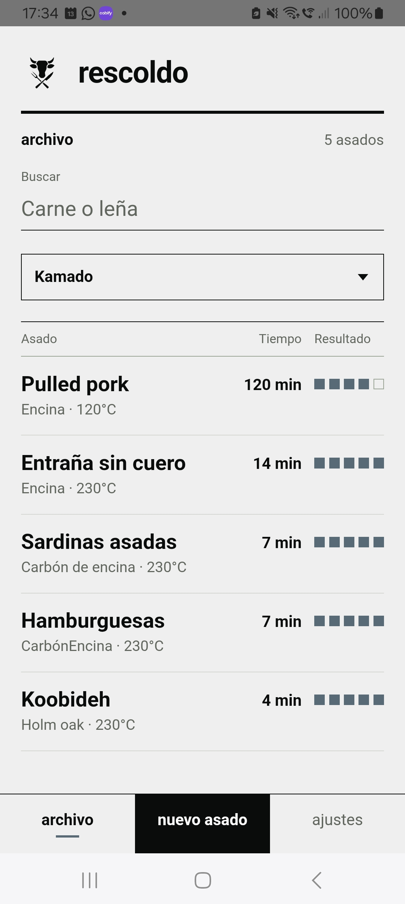
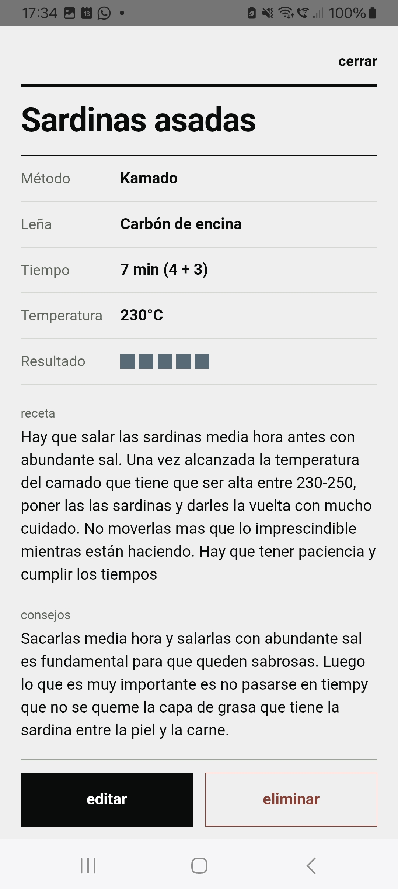
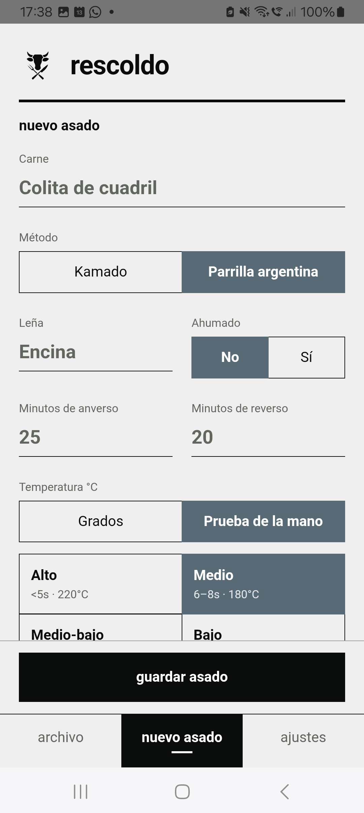
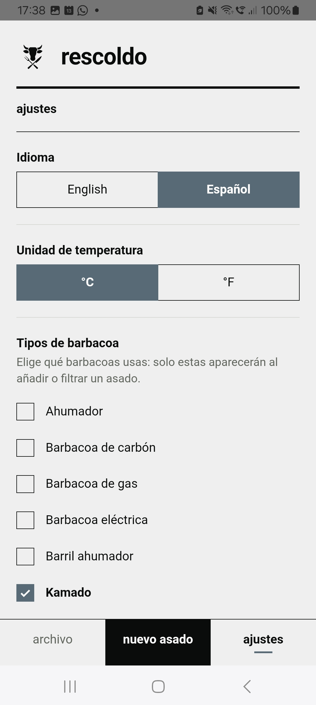

# Rescoldo

**A small, offline BBQ cook journal for your phone.** Log what you cooked, how long each side stayed on the fire, how hot it was, and what you'd change next time.

> *Rescoldo* is the Spanish word for the embers that remain after the flame dies down, which is when you actually learn something about the cook. In English: *Embers*.

<p align="center">
  
  
  
  
</p>

**Try it:** [ronsel-eu.github.io/barbacuediaries](https://ronsel-eu.github.io/barbacuediaries/)

Open it on your phone, then use the browser menu to **Add to Home Screen**. It works offline once loaded.

---

## Why I built it

Cooking with fire is a serious craft. In places like Argentina, Uruguay and Brazil it is part of the culture, and people know by heart how to cook every cut of meat. I don't. I have to research, and that research usually ends up as scraps of paper tucked inside my BBQ books. On top of that, a parrilla and a kamado are not the same thing, and you almost have to relearn how to cook on each one. So every time I cook, I end up hunting for my recipe notebook or a loose piece of paper. It's a mess.

I wanted somewhere to write down my cooks. Every app I found was too generic, too complicated, missing information I considered vital, or wanted an account for something that should just live on my phone.

I also built it to learn how to design and ship a digital product from start to finish, with AI as my collaborator: naming, visual identity, interface, code, testing, deployment.

In a nutshell: a piece of personal software that will probably only ever serve me, but is open to anyone with the same pain point, or who wants to evolve it.

## What it does

- Log a cook: meat, cooker, anverse and reverse time, temperature, smoked or not, wood, recipe, tips, and a 1-5 rating
- Temperature as degrees **or** as a hand-test level (high / medium / medium-low / low), each shown with a reference temperature so you can cross-check against a thermometer
- Archive of every cook, newest first, with search and filters
- English and Spanish interface
- °C / °F setting; history converts correctly if you switch later
- Choose which cooker types you own (kamado, parrilla, charcoal, gas, electric, barrel smoker, smoker)
- CSV backup and restore that opens in Excel, Numbers or Google Sheets, with merge-or-replace and duplicate detection
- No account, no backend, no tracking. Everything stays on your device.

## Design decisions

- **Local-first.** Entries live in the browser's `localStorage`. There is no server to run and no user data to be responsible for, so sharing the app means sharing a link.
- **Offline-first.** A service worker caches the app, because the grill is exactly where you have no signal.
- **Zero dependencies.** Vanilla HTML, CSS and JS. Even the CSV parser is hand-written, so the app stays small and nothing upstream can break it.
- **Hand-test scale with a source.** The heat levels follow the Argentine asado hand test, and the reference temperatures (220 / 180 / 160 / 140 °C) come from *El Libro* by the Escuela Argentina de Parrilleros.
- **A visual point of view.** Flat palette, strict typography and a single-color pictogram, inspired by Otl Aicher's design work. The full rationale is in [DESIGN.md](DESIGN.md).
- **Things I chose not to build.** In-app voice dictation (the phone keyboard's mic already works, and an in-app version would add a native dependency and need a network), seeded example recipes (everyone's journal should start empty), accounts and sync.

## Lessons learned

- **Verify what is actually running.** For three days my Android build was installing an old snapshot, because Capacitor builds from its own copy of the web files and I had never re-synced it. The fix was one command; the lesson was to check the built artifact, not the source.
- **Stale caches hide your own work.** A cache-first service worker kept serving the first version of the app forever. It now tries the network first and falls back to the cache only when offline.
- **Protect user data when you rename.** I renamed the app but deliberately kept the original `localStorage` keys, so existing journals did not appear empty.
- **Know when to cut scope.** It started as both a phone app and a desktop app, but the desktop version didn't make sense for how I actually cook, so I removed it.

## How it's built

- Vanilla HTML / CSS / JS in `mobile/`
- Installable PWA (manifest + service worker), deployed to GitHub Pages by a GitHub Actions workflow on every push to `main`
- [Capacitor](https://capacitorjs.com/) wraps the same code as a native Android app
- Whole interface designed in Paper Pro
- Built with AI assistance (Claude), directed and reviewed by me

## Run it locally

```bash
npm install
npm run mobile
```

Open the printed URL. To test on a phone, connect it to the same Wi-Fi network as your computer and open the same address.

### Build the Android app

Requires Android Studio, the Android SDK and a compatible JDK.

```bash
npm run android:sync   # run after every change under mobile/
npm run android:open
```

Then in Android Studio: **Build > Build App Bundle(s) / APK(s)**.

## Limitations

- Single user, single device. There is no sync; use CSV export and import to move cooks between devices.
- Not yet published on Google Play. The PWA is the supported way to install.
- The interface uses Argentine asado terminology (anverso, reverso, hand-test scale).

## License

[MIT](LICENSE)

## Feedback

Have an idea to make it better? Want to suggest a new cooker type or cooking method? Or just want to tell me something? [Open an issue](https://github.com/ronsel-eu/barbacuediaries/issues) and let me know.
